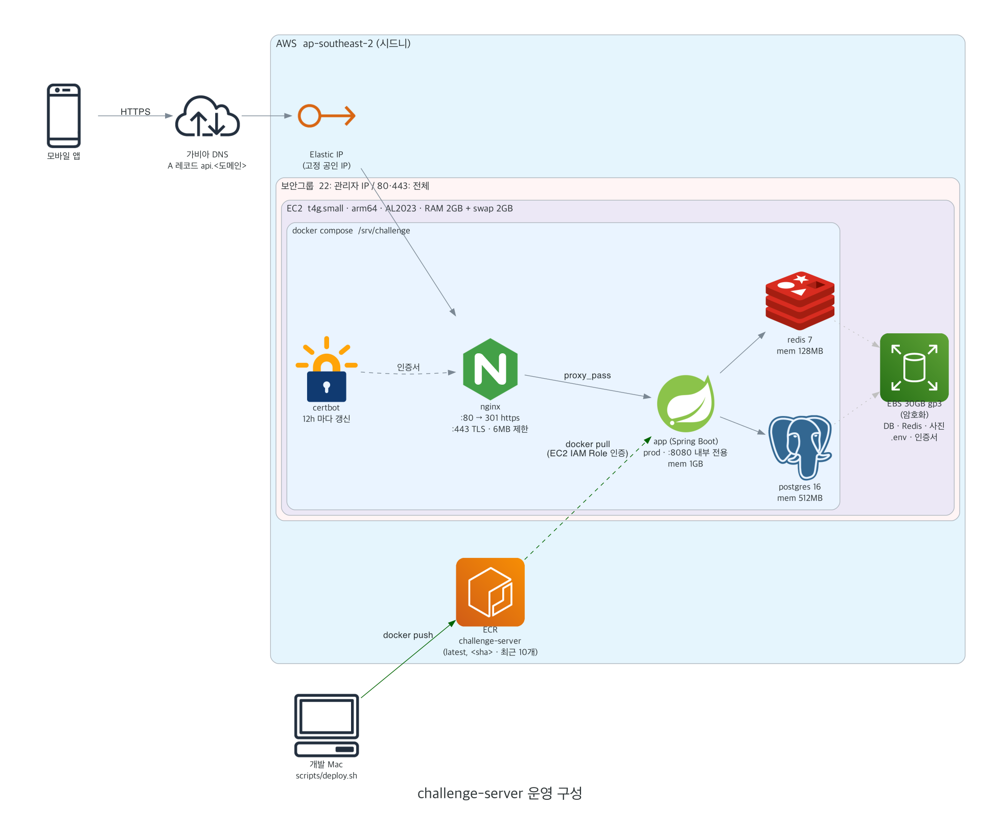

# 배포 (EC2 한 대 + docker compose)

## 서버 구성



> 그림 원본: `architecture.py` (구성이 바뀌면 파일 상단 안내대로 다시 생성)

| 항목 | 값 |
|---|---|
| 도메인 | `api.<도메인>` (가비아, 네임서버 기본값) — 실제 값은 EC2 `.env` 의 `DOMAIN`, 로컬 `deploy/.env.deploy` 의 `HOST` |
| 리전 | `ap-southeast-2` 시드니 — AWS 신규 가입 방식(프로젝트)은 한국 주소면 시드니로 고정된다 |
| EC2 | `challenge-server` · t4g.small · 종료 보호 ON · EBS `DeleteOnTermination=false` · IMDSv2 필수 |
| 고정 IP | Elastic IP (가비아 A 레코드 `api` 가 가리키는 값) — 인스턴스를 지워도 남아 과금된다. 정리 시 release 할 것 |
| 이미지 | `<계정ID>.dkr.ecr.ap-southeast-2.amazonaws.com/challenge-server` |
| 비밀값 | `/srv/challenge/.env` (chmod 600) — DB 비밀번호·JWT 키는 서버에서 생성, 레포·로컬에 없음 |
| 접속 | `ssh -i ~/.ssh/challenge-server.pem ec2-user@api.<도메인>` (또는 SSM Session Manager) |

## 파일

| 경로 | 내용 |
|---|---|
| `../Dockerfile` | 실행 이미지. 호스트에서 만든 `app/build/libs/app.jar` 를 복사만 한다 |
| `docker-compose.yml` | app / postgres / redis + (`https` 프로필) nginx / certbot |
| `nginx/templates/default.conf.template` | HTTPS 종료, 80→443 리다이렉트, 업로드 6MB, WebSocket |
| `.env.example` | 환경변수 목록. 복사해서 `.env` 로 쓴다 (커밋 금지) |
| `secrets/fcm.json` | FCM 서비스 계정 키 (커밋 금지, 직접 둔다) |

## 1. 로컬 검증

```bash
./gradlew :app:bootJar
docker build -t challenge-server:local .

cd deploy
cp .env.example .env   # DB_PASSWORD, JWT_SECRET 채우기. COMPOSE_PROFILES / APP_IMAGE 는 비워 둔다
docker compose up -d
docker compose logs -f app
curl localhost:8080/actuator/health   # {"status":"UP"}
```

확인할 것: Flyway 마이그레이션 성공, 로그인, 사진 업로드 → `docker compose restart app` 후에도 사진 조회.

## 2. 이미지 push (Mac → ECR)

```bash
REGISTRY=<계정ID>.dkr.ecr.ap-northeast-2.amazonaws.com
./gradlew :app:bootJar
# --provenance/--sbom=false: 끄지 않으면 BuildKit 이 attestation 을 붙여 "이미지 인덱스"로 올린다.
#   그러면 ECR 기본 스캔이 결과를 내지 않고, 부속 매니페스트가 수명 주기 정책(최근 10개)의 개수를 잡아먹는다.
docker build --platform linux/arm64 --provenance=false --sbom=false -t $REGISTRY/challenge-server:latest .
aws ecr get-login-password | docker login --username AWS --password-stdin $REGISTRY
docker push $REGISTRY/challenge-server:latest
```

## 3. EC2 최초 설정 (한 번만)

```bash
# /srv/challenge 에 deploy/ 내용(docker-compose.yml, nginx/)을 올린다
cd /srv/challenge
cp .env.example .env && chmod 600 .env   # COMPOSE_PROFILES=https, APP_IMAGE, DOMAIN 등 채우기

# FCM 키 — 컨테이너 사용자(UID 10001)만 읽게 한다
mkdir -p secrets && mv ~/fcm.json secrets/fcm.json
sudo chown 10001:10001 secrets/fcm.json && sudo chmod 400 secrets/fcm.json

# 인증서 최초 발급 — nginx 가 뜨기 전에 standalone 으로 (80 포트가 비어 있어야 한다)
set -a; . ./.env; set +a
# 이메일을 등록하지 않으면(--register-unsafely-without-email) 만료 경고 메일만 못 받는다. 갱신은 certbot 컨테이너가 한다.
# 먼저 --dry-run 으로 확인 — 실패를 반복하면 Let's Encrypt 발급 제한(rate limit)에 걸린다.
docker compose run --rm -p 80:80 --entrypoint certbot certbot \
  certonly --standalone -d "$DOMAIN" --register-unsafely-without-email --agree-tos --non-interactive

# 갱신 경로 점검 (non-interactive renew 는 기본으로 최대 8분 무작위 대기한다 — 테스트 땐 끈다)
docker compose exec certbot certbot renew --webroot -w /var/www/certbot --dry-run --no-random-sleep-on-renew

aws ecr get-login-password | docker login --username AWS --password-stdin <계정ID>.dkr.ecr.ap-northeast-2.amazonaws.com
docker compose up -d
```

이후 갱신은 certbot 컨테이너(12시간마다 `renew`)와 nginx(6시간마다 reload)가 알아서 한다.

## 4. 재배포

```bash
cd /srv/challenge
docker compose pull app && docker compose up -d app
```

## 배포 후 확인

- `curl https://$DOMAIN/actuator/health` → `{"status":"UP"}`
- `docker compose logs app | grep -E "활성|비활성"` — FCM / Gemini / Kakao unlink 가 **활성**인지.
  키가 비어 있어도 서버는 정상 기동하므로 이 로그가 유일한 신호다.
- 운영 `.env` 에 `CHALLENGE_DEV_TEST_LOGIN_ENABLED` 가 **없어야** 한다 (테스트 로그인 = 인증 우회).
